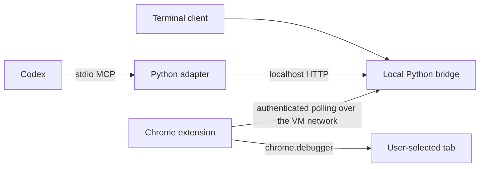

# Chromebook Browser Bridge

**Browser control from Codex on a low-spec Chromebook.**

A small, dependency-free bridge between a Linux terminal and a Chrome tab you
choose. Use it to inspect pages, take screenshots, test forms, and check responsive
layouts. An optional stdio MCP adapter exposes the same actions as agent tools.

Built and tested on a Samsung Chromebook 4 with an Intel Celeron N4020 and 4 GB
RAM. This is an early personal project, tested on one device—not a general
ChromeOS desktop-control system or an official OpenAI/Google integration.

## What works

| Tool | Result |
| --- | --- |
| `browser_status` | Connection state and the selected tab |
| `browser_snapshot` | Text, visible control selectors, checkboxes, select options, viewport |
| `browser_screenshot` | PNG of the selected tab |
| `browser_navigate` | Navigate the selected tab |
| `browser_click` | Scroll instantly, wait for a stable target, check for covering elements, click |
| `browser_type` | Replace text in a field; password fields are refused |
| `browser_select` | Select a native dropdown option |
| `browser_scroll` | Scroll by CSS pixels |
| `browser_key` | Enter, Escape, Tab, Backspace, ArrowUp, ArrowDown |
| `browser_viewport` | Set a test viewport or restore the normal view |

The owner explicitly connects a tab. Chrome shows a debugging banner, and either
the extension's Disconnect button or canceling the banner stops access.

## Requirements

- A Chromebook with the Linux development environment enabled and Chrome 118+.
- Python 3.10+ in Linux; Git to clone the repository.
- Permission to load an unpacked extension. Managed-device policy may prevent it.
- Codex CLI only if you want Codex MCP integration. The terminal client works without it.
- Node.js is optional, for the JavaScript tests. No npm or pip packages are required.

**ChromeOS Developer Mode, host SSH, firmware changes, and root filesystem
changes are not required.** The Developer mode switch on `chrome://extensions`
is a separate extension-development setting.

## Install

In the Linux terminal:

```sh
git clone https://github.com/FrenchieFam/chromebook-browser-bridge.git
cd chromebook-browser-bridge
python3 install.py --start --register-codex --install-skill
```

Omit `--register-codex` and `--install-skill` if you only want the terminal client.
The installer writes to your own home and ChromeOS Downloads; it does not use sudo
or download packages. It creates a random pairing token, a local user service,
terminal launchers, and an unpacked extension folder.

Then in ChromeOS Chrome:

1. Open `chrome://extensions`.
2. Enable the extension page's **Developer mode** toggle.
3. Choose **Load unpacked**, then **Downloads → Chromebook-Browser-Bridge**.
4. Open an ordinary web page.
5. Open **Chromebook Browser Bridge** from the extension menu and choose
   **Connect this tab**. Close the popup.

The installer prints the extension path. If Downloads sharing is different, pass
`--extension-dir /path/to/a/ChromeOS-accessible/folder`. An extension loaded in
ChromeOS must be stored somewhere ChromeOS can read.

The bridge service starts with the Linux user session. It does not boot Linux at
Chromebook startup or automatically reconnect a Chrome tab. Codex may need to
reload its MCP configuration or start a new session to discover a newly added
server. The command-line client remains available immediately.

### Try it

```sh
~/.local/bin/chromebook-browser status
~/.local/bin/chromebook-browser snapshot
~/.local/bin/chromebook-browser screenshot --output /tmp/tab.png
~/.local/bin/chromebook-browser select --args '{"selector":"#status","value":"completed"}'
~/.local/bin/chromebook-browser viewport --args '{"width":390,"height":844}'
~/.local/bin/chromebook-browser viewport --args '{"reset":true}'
```

Use real selectors returned by a fresh snapshot. Inspect the result after actions.
Reset viewport emulation after testing. For more commands, run
`~/.local/bin/chromebook-browser --help`.

In Codex, ask it to use the `chromebook-browser` MCP server to check connection,
read the selected test page, and verify one specific interaction.

## How the pieces connect



The bridge keeps a small in-memory command queue. The extension polls for a
command, acts on the selected tab, and returns the result. A timeout does not
prove that an action failed; inspect before retrying a submission.

- Installed runtime: `~/.local/share/chromebook-browser-bridge`
- Pairing token: `~/.config/chromebook-browser-bridge/token`
- User service: `chromebook-browser-bridge.service`
- MCP server name: `chromebook-browser`
- Optional skill: `~/.codex/skills/chromebook-browser-bridge`

## Reconnect, update, and remove

After restarting the Chromebook: open Linux, then connect a tab from the extension.
If the VM IP changes, rerun the installer from your checkout and reload the
extension. An existing pairing token is preserved. You can specify an IPv4 address
with `--endpoint-host`; the installer otherwise reads the Linux route without
sending a request to that destination.

Update: pull reviewed source changes, rerun the same installer command, reload
the extension, and reconnect a tab. The installer restarts the user service when
`--start` is supplied. Pending commands are lost when that service restarts.

To stop and disable the service:

```sh
systemctl --user disable --now chromebook-browser-bridge.service
codex mcp remove chromebook-browser
```

Remove the unpacked extension in Chrome. See [the setup guide](docs/setup.md)
for remaining file locations, troubleshooting, and optional cleanup.

## Limits and trust

This controls a selected browser tab, including signed-in pages. It does not
control the ChromeOS desktop, system dialogs, other apps, or all your tabs.
Cross-origin iframes, shadow DOM, custom dropdown abstractions, file upload dialogs,
and automatic login are not implemented. File URLs may need Chrome's **Allow
access to file URLs** setting. Internal `chrome://` pages are unsupported.

The service listens on the VM's port 8765 so ChromeOS can reach it. Requests use a
random bearer token; ordinary web-page origins are rejected. The guest-network
transport is HTTP, not TLS. Keep this as a personal local tool: do not forward the
port to the internet or expose it as a public service. See [security notes](SECURITY.md).

`config.js` contains a pairing token and is generated locally. **Never publish a
paired extension folder.** This repository ships only an example configuration.
Model outputs and page text still require judgment; browser access doesn't make
website content trustworthy or remove account authorization requirements.

## Tests and experience

```sh
python3 -m unittest discover -p 'test_*.py' -v
node --test test_worker.cjs
```

The source tests cover HTTP authentication/origins, command/result delivery,
MCP messages and tool arguments, installer token preservation, and click guards.
The original live setup also passed dropdown/checkbox interactions, screenshots,
and 390×844 / 1280×900 viewport checks on its test site.

The portable installer is tested in an isolated temporary home; broader-device
installation testing is still welcome. [Read the build story](docs/build-story.md)
and [the specific validation record](docs/validation.md).

## License

[MIT](LICENSE). Built by [FrenchieFam](https://github.com/FrenchieFam).
