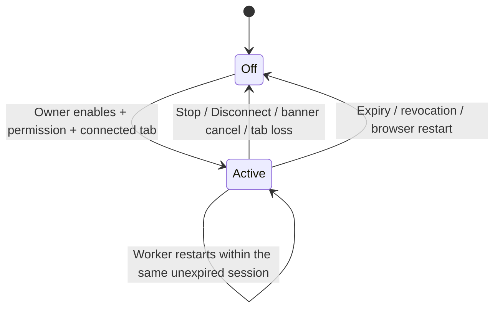

# Optional timed keep-awake — v0.4.0

This feature is off by default. It uses Chrome's `power` API at the `system`
level: prevent idle system sleep while allowing the display to dim/turn off.
It never calls reportActivity or requests the stronger display level.
It does not change ChromeOS power preferences, lid behavior or screen locking.

## Enable and stop

1. Update the bridge runtime and reload the extension in chrome://extensions.
2. Connect a normal tab or start persistent work mode.
3. In the extension popup, choose 1 minute for a quick expiry check, or 15, 30 or 60
   minutes for work. Click Enable keep-awake. Chrome asks for the optional power
   permission on first use; declining leaves the feature off.
4. The popup shows remaining time. Restart timer explicitly begins a new duration;
   it does not silently extend on activity. Stop releases the request immediately.

Disconnect, Chrome banner cancellation, tab loss, permission revocation, browser
restart and extension reload also release it. Ordinary service-worker restart can
restore only the remaining duration within the same browser session, with a
connected tab and permission still present. It does not create a new lease.
The Linux/MCP tools can observe wake status through authenticated heartbeats;
there is no tool or HTTP command to enable or extend it. Only the popup can start.

## Power settings and physical checks

Keep the lid open. A wake request does not promise operation through closing the
lid, shutdown, critical battery or managed policy. Existing Keep display on
preferences can still keep the screen lit; this feature does not turn it off.
A request being active is not hardware telemetry or proof of screen-off browser
input. Use SSH for ordinary Linux work; inspect visibility before browser input.

The deadline is checked in status/heartbeat paths as well as a Chrome expiry alarm.
Chrome/OS scheduling can delay handling an alarm; this is not a hard real-time
power cutoff. A suspended or powered-off machine cannot execute a callback.

Automated checks cover permission denial, invalid duration, races, expired/corrupt
session state, API failures, service-worker restoration, stop/banner/tab-loss,
permission revocation and browser startup. The popup was tested in an actual
360px browser preview with simulated extension APIs; it is not a hardware test.
On the Lenovo, the owner confirmed the native popup after an intrinsic-width
fix. A real one-minute session was observed active in authenticated 0.4.0
heartbeats, then automatically inactive after its original deadline. This verifies
actual extension activation/expiry, not OS wake telemetry. A configured15-minute battery idle-Sleep check also passed: the owner confirmed
the display was off, while SSH/browser heartbeats stayed available through the
active session and an inactive lease was observed after the deadline. Battery
reported82% at the first active observation and80% at expiry. This is a sampled
one-device result, not a battery benchmark or closed-lid guarantee.

References:
- https://developer.chrome.com/docs/extensions/reference/api/power
- https://developer.chrome.com/docs/extensions/reference/api/permissions
- https://developer.chrome.com/docs/extensions/reference/api/storage

## Session lifecycle

The native popup has an intrinsic minimum width so Chrome can size it before
its viewport exists. Testing only a fixed-width browser preview missed the first
native popup sizing issue; the owner confirmed the corrected real menu on Lenovo.
